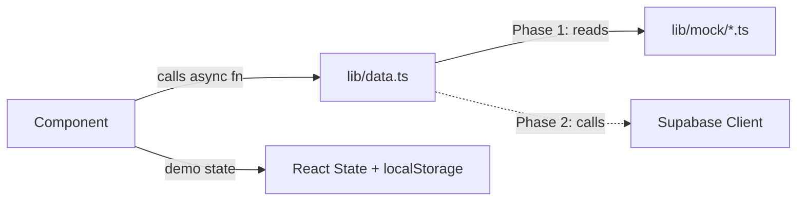

# Architecture

> Technical architecture for the HerCircle prototype (Phase 1).

---

## Stack

| Layer | Technology |
|---|---|
| Framework | Next.js 14+ (App Router) |
| Language | TypeScript (strict mode) |
| Styling | Tailwind CSS |
| Components | shadcn/ui primitives |
| Icons | Lucide React |
| Fonts | **Fraunces** (serif — headings) + **DM Sans** (sans — UI text) via `next/font` |
| Data | Mock data layer (designed for Supabase swap in Phase 2) |

---

## Folder Structure

```
src/
├── app/
│   ├── layout.tsx              # Root layout, font loading, providers
│   ├── page.tsx                # Landing / home
│   ├── globals.css             # CSS custom properties, Tailwind base
│   │
│   ├── (public)/               # Visitor routes (no auth required)
│   │   ├── how-it-works/
│   │   ├── apply/
│   │   ├── sign-in/
│   │   ├── sign-up/
│   │   ├── pending/
│   │   ├── guidelines/
│   │   └── safety/
│   │
│   ├── (member)/               # Authenticated member routes
│   │   ├── feed/
│   │   ├── circles/[slug]/
│   │   ├── discussions/new/
│   │   ├── discussions/[id]/
│   │   ├── ask/
│   │   ├── elder-sister/
│   │   ├── mentors/[id]/
│   │   ├── saved/
│   │   ├── notifications/
│   │   ├── profile/[id]/
│   │   ├── settings/
│   │   └── help/
│   │
│   ├── (mod)/                  # Moderator routes
│   │   └── mod/
│   │       ├── dashboard/
│   │       ├── reports/
│   │       ├── applications/
│   │       └── community/
│   │
│   └── design-system/          # Dev-only component showcase
│
├── components/
│   ├── ui/                     # shadcn primitives (Button, Dialog, etc.)
│   ├── layout/                 # Shell, nav, sidebar, mobile bottom bar
│   ├── community/              # PostCard, CommentThread, Poll, etc.
│   ├── mentorship/             # MentorCard, GuidanceRequest
│   ├── moderation/             # ModControls, ReportDialog
│   └── shared/                 # EmptyState, Skeleton, ErrorState,
│                               # PrivacyNotice, CrisisBanner, DemoBadge
│
├── lib/
│   ├── mock/                   # Seed data files
│   │   ├── users.ts
│   │   ├── circles.ts
│   │   ├── discussions.ts
│   │   ├── mentors.ts
│   │   ├── reports.ts
│   │   └── notifications.ts
│   ├── data.ts                 # Async data-access functions
│   ├── types.ts                # Shared TypeScript types
│   └── utils.ts                # Helpers (cn, formatDate, etc.)
│
├── contexts/
│   └── auth-context.tsx        # Demo auth with role switching
│
└── hooks/                      # Custom React hooks
```

### Route Groups

- **`(public)`** — No authentication. Visitor-facing pages like onboarding, sign-in, and community guidelines.
- **`(member)`** — Requires authenticated session. Core community experience.
- **`(mod)`** — Requires moderator role. Content moderation and community management tools.

> [!NOTE]
> Route groups use Next.js parenthesised folders — they affect layout nesting but don't appear in URLs. `/feed` not `/(member)/feed`.

---

## Data Flow



### Phase 1 (Prototype)

1. Components call async functions from `lib/data.ts` (e.g. `getDiscussions()`, `getCircleBySlug()`).
2. `data.ts` reads from `lib/mock/*.ts` seed data files.
3. Demo-only state (saves, new posts, reactions) is stored in React state with optional `localStorage` persistence — clearly labelled as demo-only in code and UI.

### Phase 2 (Production Swap)

- `data.ts` swaps to Supabase client calls.
- **Zero component changes required** — the async function interface stays identical.

> [!IMPORTANT]
> No sensitive data is ever stored in localStorage. See [DECISIONS.md](./DECISIONS.md) #13.

---

## Design Tokens

### Colour Palette

Defined as CSS custom properties in `globals.css` and extended into the Tailwind config:

| Token | Value | Usage |
|---|---|---|
| `--color-ivory` | `#F8F4EF` | Background / canvas |
| `--color-lavender` | `#B8A9C9` | Secondary accent |
| `--color-sage` | `#A8B5A0` | Success / nature tones |
| `--color-rose` | `#C87982` | Primary accent (large text & decorative only) |
| `--color-charcoal` | `#292631` | Body text / high-contrast elements |

> [!WARNING]
> Dusty rose on ivory **fails WCAG AA for small text** (contrast ratio ~3.8:1). Use charcoal for all body text. Rose is restricted to accents, decorative elements, and large headings. See [DECISIONS.md](./DECISIONS.md) #2.

### Type Scale

| Token | Size | Line Height |
|---|---|---|
| `xs` | 0.75rem | 1rem |
| `sm` | 0.875rem | 1.25rem |
| `base` | 1rem | 1.5rem |
| `lg` | 1.125rem | 1.75rem |
| `xl` | 1.25rem | 1.75rem |
| `2xl` | 1.5rem | 2rem |
| `3xl` | 1.875rem | 2.25rem |
| `4xl` | 2.25rem | 2.5rem |

- **Fraunces** (serif) — headings, display text
- **DM Sans** (sans-serif) — body, UI text

---

## Deployment

- **Vercel-compatible** — standard Next.js build output.
- No server-side data fetching in prototype (all mock data is bundled client-side).
- No environment variables required for Phase 1.
