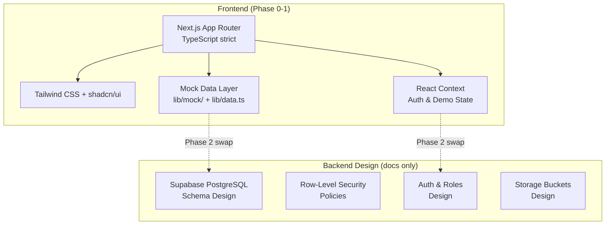

# HerCircle — Implementation Plan & Task List

> **Status**: Awaiting approval before any code is written.

## Executive Summary

HerCircle is an India-first, private women's community and mentorship platform. Phase 0–1 delivers comprehensive documentation plus a polished, responsive, clickable Next.js frontend prototype with mock data. The backend is **designed** (schema, RLS, auth model) but **not built**.

---

## Architecture Overview



### Key Technical Decisions

| Decision | Choice | Rationale |
|----------|--------|-----------|
| Router | App Router (Next.js 14+) | Server components, layouts, loading/error states |
| Styling | Tailwind + CSS variables | Design tokens as CSS vars, consumed by Tailwind |
| Components | shadcn/ui | Accessible, unstyled primitives we fully own |
| Icons | Lucide | Tree-shakeable, consistent |
| Fonts | Fraunces (serif headings) + DM Sans (UI) | Elegant + readable, both on Google Fonts |
| State | React Context + `useState` | Sufficient for prototype; no Redux overhead |
| Mock data | `lib/mock/*.ts` → `lib/data.ts` async API | Clean swap path to Supabase |
| Demo state | localStorage (labeled) | Persists demo interactions across refreshes |
| Auth simulation | Context provider with role switching | Lets reviewer test all 4 roles |

---

## Checkpoint Breakdown & Task List

### Checkpoint 0: Documentation
> **Goal**: Complete design documentation before writing code.

- [ ] **T0.1** — `docs/PRD.md`: Product requirements, personas, roles table, eligibility policy, mentorship model, safety principles, privacy commitments
- [ ] **T0.2** — `docs/ARCHITECTURE.md`: Tech stack, folder structure, data flow, component hierarchy, deployment model
- [ ] **T0.3** — `docs/USER_FLOWS.md`: All user journeys with sitemap diagram, page inventory
- [ ] **T0.4** — `docs/DATABASE_SCHEMA.md`: Full Supabase PostgreSQL schema (tables, types, indexes, relationships), RLS policies, storage buckets
- [ ] **T0.5** — `docs/SECURITY_MODEL.md`: Roles/permissions matrix (CRUD per resource), threat model, RLS enforcement, anonymous identity isolation, audit logging design
- [ ] **T0.6** — `docs/IMPLEMENTATION_PLAN.md`: This document (copied into repo)
- [ ] **T0.7** — `docs/DECISIONS.md`: Assumptions, trade-offs, deferrals with rationale
- [ ] **T0.8** — Review: List critical assumptions, security risks, product trade-offs, recommended deferrals

### Checkpoint 1: Foundation
> **Goal**: Design system, layout shell, all reusable components.

- [ ] **T1.1** — Next.js project setup (TypeScript strict, Tailwind, shadcn/ui, folder structure)
- [ ] **T1.2** — Design tokens: CSS variables for colors, spacing, radii, shadows; Tailwind config extension
- [ ] **T1.3** — Font setup via `next/font` (Fraunces + DM Sans), type scale definition
- [ ] **T1.4** — Layout shell: `<RootLayout>` with prototype banner, responsive nav
- [ ] **T1.5** — Desktop sidebar navigation
- [ ] **T1.6** — Mobile bottom bar + hamburger menu sheet
- [ ] **T1.7** — Auth context provider with role switcher (dev tool)
- [ ] **T1.8** — Mock data layer (`lib/mock/`, `lib/data.ts`)
- [ ] **T1.9** — Reusable components:
  - [ ] T1.9a — PostCard (discussion card with metadata, reactions, content warning)
  - [ ] T1.9b — TopicChip (circle/category badge)
  - [ ] T1.9c — MentorCard (experience-based profile card)
  - [ ] T1.9d — ReactionBar (supportive reactions + "helpful" indicator)
  - [ ] T1.9e — CommentThread (nested replies, max 3 levels)
  - [ ] T1.9f — PrivacyNotice (contextual privacy info)
  - [ ] T1.9g — ContentWarningWrapper (blur + reveal)
  - [ ] T1.9h — Poll component
  - [ ] T1.9i — ModerationControls (pin, lock, remove, escalate)
  - [ ] T1.9j — ReportDialog (category, description, submit)
  - [ ] T1.9k — EmptyState (illustration + CTA)
  - [ ] T1.9l — SkeletonLoader (content-shaped placeholders)
  - [ ] T1.9m — ErrorState (retry action)
  - [ ] T1.9n — CrisisResourceBanner (in-context, India-relevant)
  - [ ] T1.9o — DemoBadge ("Demo data" indicator)
  - [ ] T1.9p — PrototypeBanner (persistent, dismissible)
- [ ] **T1.10** — `/design-system` page showing all tokens, type scale, components in all states
- [ ] **T1.11** — Accessibility baseline: focus rings, skip links, semantic landmarks, reduced-motion

### Checkpoint 2: Public Pages
> **Goal**: All visitor-accessible pages, membership application flow.

- [ ] **T2.1** — Landing page (hero, value props, belonging + safety messaging, CTA)
- [ ] **T2.2** — How HerCircle Works (process explanation, safety commitments)
- [ ] **T2.3** — Membership Application (multi-step form: personal info, interests, agreement to guidelines, review step)
- [ ] **T2.4** — Sign In / Sign Up pages (mocked auth, labeled)
- [ ] **T2.5** — Membership Pending Approval page
- [ ] **T2.6** — Community Guidelines page (comprehensive, India-aware)
- [ ] **T2.7** — Privacy and Safety Information page (crisis resources, data rights, privacy explainer)

### Checkpoint 3: Member Core
> **Goal**: The heart of the product — feed, circles, discussions.

- [ ] **T3.1** — Member Home Feed (greeting, topic discovery, circle recommendations, discussion feed, Ask an Elder Sister entry, mentor highlights, trending)
- [ ] **T3.2** — Explore Circles page (grid/list, search, categories)
- [ ] **T3.3** — Circle Detail page (rules, moderators, description, discussion feed, resources)
- [ ] **T3.4** — Discussion Detail page (nested replies, reactions, save, report, content warnings)
- [ ] **T3.5** — Create Discussion composer (named/anonymous toggle with explanation, content warning, image placeholder, optional poll, circle selection)
- [ ] **T3.6** — Anonymous Question Composer (clear pseudonymity explanation)
- [ ] **T3.7** — Seed 9 circles with descriptions, rules, moderators
- [ ] **T3.8** — Seed 30+ discussions with varied content across circles
- [ ] **T3.9** — Working flows: create discussion → appears in feed; reply with nesting; save/unsave

### Checkpoint 4: Mentorship & Personal Pages
> **Goal**: Mentorship system, user profile/settings, notifications.

- [ ] **T4.1** — Ask an Elder Sister landing page (explanation, recent questions, featured mentors)
- [ ] **T4.2** — Mentor Directory (filters by topic, experience area; grid layout)
- [ ] **T4.3** — Mentor Profile page (experience narrative, public Q&A, request guidance)
- [ ] **T4.4** — Saved Discussions page
- [ ] **T4.5** — Notifications page (interaction types, read/unread)
- [ ] **T4.6** — Member Profile page (bio, activity, circles, posts)
- [ ] **T4.7** — Member Settings page (privacy controls, blocking, data export, account deletion — all labeled as mocked flows)
- [ ] **T4.8** — Report Content Dialog (accessible from any content)
- [ ] **T4.9** — Help Center page
- [ ] **T4.10** — Seed 12+ mentor profiles with realistic India-aware data

### Checkpoint 5: Moderation
> **Goal**: Moderator tools for community management.

- [ ] **T5.1** — Moderator Dashboard (stats overview, pending items, quick actions)
- [ ] **T5.2** — Report Review Queue (open, escalate, resolve, add notes)
- [ ] **T5.3** — Membership Review Queue (approve, request info, decline with reason)
- [ ] **T5.4** — Community Management (circle rules editing, moderator assignment — mocked)

### Checkpoint 6: Quality Assurance
> **Goal**: Polish, fix, verify, document.

- [ ] **T6.1** — Responsive testing: mobile (375px), tablet (768px), desktop (1280px+)
- [ ] **T6.2** — Navigation audit: every link resolves, no dead routes
- [ ] **T6.3** — Form validation: all forms show clear error/success states
- [ ] **T6.4** — Empty/loading/error states for every list and data view
- [ ] **T6.5** — Keyboard navigation and focus order verification
- [ ] **T6.6** — Screen reader semantics: headings, landmarks, aria-live
- [ ] **T6.7** — Reduced-motion: all animations respect `prefers-reduced-motion`
- [ ] **T6.8** — Performance: image sizing, font loading, no layout shift
- [ ] **T6.9** — Authorization boundaries review against SECURITY_MODEL.md
- [ ] **T6.10** — QA report with findings and screenshots
- [ ] **T6.11** — README.md with setup instructions
- [ ] **T6.12** — Final deliverables checklist

---

## Folder Structure (Planned)

```
HerCircle/
├── docs/
│   ├── PRD.md
│   ├── ARCHITECTURE.md
│   ├── USER_FLOWS.md
│   ├── DATABASE_SCHEMA.md
│   ├── SECURITY_MODEL.md
│   ├── IMPLEMENTATION_PLAN.md
│   └── DECISIONS.md
├── src/
│   ├── app/
│   │   ├── layout.tsx                    # Root layout + prototype banner
│   │   ├── page.tsx                      # Landing page
│   │   ├── globals.css                   # Design tokens, base styles
│   │   ├── (public)/                     # Visitor-accessible routes
│   │   │   ├── how-it-works/
│   │   │   ├── apply/
│   │   │   ├── sign-in/
│   │   │   ├── sign-up/
│   │   │   ├── pending/
│   │   │   ├── guidelines/
│   │   │   └── safety/
│   │   ├── (member)/                     # Authenticated member routes
│   │   │   ├── feed/
│   │   │   ├── circles/
│   │   │   │   └── [slug]/
│   │   │   ├── discussions/
│   │   │   │   ├── new/
│   │   │   │   └── [id]/
│   │   │   ├── ask/                      # Anonymous questions
│   │   │   ├── elder-sister/             # Mentorship landing
│   │   │   ├── mentors/
│   │   │   │   └── [id]/
│   │   │   ├── saved/
│   │   │   ├── notifications/
│   │   │   ├── profile/
│   │   │   │   └── [id]/
│   │   │   ├── settings/
│   │   │   └── help/
│   │   ├── (mod)/                        # Moderator routes
│   │   │   ├── mod/
│   │   │   │   ├── dashboard/
│   │   │   │   ├── reports/
│   │   │   │   ├── applications/
│   │   │   │   └── community/
│   │   └── design-system/                # Dev-only design system page
│   ├── components/
│   │   ├── ui/                           # shadcn/ui primitives
│   │   ├── layout/                       # Shell, nav, sidebar, mobile bar
│   │   ├── community/                    # PostCard, CommentThread, Poll, etc.
│   │   ├── mentorship/                   # MentorCard, GuidanceRequest
│   │   ├── moderation/                   # ModControls, ReportDialog, Queues
│   │   └── shared/                       # EmptyState, Skeleton, ErrorState, etc.
│   ├── lib/
│   │   ├── mock/                         # Mock data files
│   │   │   ├── users.ts
│   │   │   ├── circles.ts
│   │   │   ├── discussions.ts
│   │   │   ├── mentors.ts
│   │   │   ├── reports.ts
│   │   │   └── notifications.ts
│   │   ├── data.ts                       # Async data-access layer
│   │   ├── types.ts                      # Shared TypeScript types
│   │   └── utils.ts                      # Helpers
│   ├── contexts/
│   │   └── auth-context.tsx              # Demo auth with role switching
│   └── hooks/
│       ├── use-local-storage.ts
│       └── use-demo-state.ts
├── public/
│   └── images/                           # Placeholder illustrations
├── package.json
├── tsconfig.json
├── tailwind.config.ts
├── next.config.ts
└── README.md
```

---

## Risk Register

| Risk | Severity | Mitigation |
|------|----------|------------|
| Prototype treated as production | High | Persistent banner, "Demo data" badges, mocked labels everywhere |
| Mock auth gives false security confidence | High | Clear docs + UI warnings; no real credentials accepted |
| Color contrast failures (dusty rose on ivory) | Medium | Use dusty rose only for decorative/large text; charcoal for body text |
| Scope creep beyond brief | Medium | Strict adherence to checkpoint tasks; DECISIONS.md for deferrals |
| Accessibility regressions | Medium | Design-system page tests all states; manual keyboard testing per checkpoint |
| Mock data stereotypes | Medium | Diverse, realistic Indian seed data reviewed for stereotypes |

---

## Critical Assumptions

1. **No real authentication** — The prototype simulates auth via React Context with a role switcher. No passwords, no tokens, no sessions.
2. **No real database** — All data lives in TypeScript mock files and optional localStorage for demo interactions.
3. **No real file uploads** — Image placeholders only.
4. **No real-time features** — No WebSocket, no polling. Notifications are static mock data.
5. **No AI/ML features** — No content moderation AI, no recommendation engine.
6. **India-first but English** — UI is in English; seed data reflects Indian context.
7. **Mentorship is public** — No private messaging in MVP. Guidance requests are public threads.
8. **Age floor is 18+** — Wait, the brief says "12+" in the eligibility section but "18+" in the opening line. **I will use 18+ as the product positioning (adults) but note that the eligibility section says 12+. I'll record this in DECISIONS.md and use 18+ for the application form as it's more conservative for a community handling sensitive topics.**

## Features Recommended for Deferral

| Feature | Reason |
|---------|--------|
| Real-time notifications | Requires WebSocket/Supabase Realtime; Phase 2 |
| Image uploads | Requires storage buckets + signed URLs; Phase 2 |
| Search (full-text) | Requires PostgreSQL FTS or Algolia; Phase 2 |
| Email notifications | Requires email service integration; Phase 2 |
| Content moderation AI | Requires ML pipeline; Phase 2+ |
| Multi-language support | Requires i18n framework; Phase 2+ |
| Mobile app | Requires React Native or PWA work; Phase 3+ |
| Private messaging (even limited) | Requires careful safety design; Phase 2+ |
| Mentor verification | Requires identity verification flow; Phase 2+ |

---

## Estimated Effort per Checkpoint

| Checkpoint | Est. Tasks | Complexity |
|------------|-----------|------------|
| 0: Documentation | 8 | Medium — thorough design docs |
| 1: Foundation | 11 | High — design system + all components |
| 2: Public Pages | 7 | Medium — mostly static/form pages |
| 3: Member Core | 9 | High — interactive feed, discussions, circles |
| 4: Mentorship & Personal | 10 | Medium-High — many distinct pages |
| 5: Moderation | 4 | Medium — dashboard + queues |
| 6: QA | 12 | Medium — testing + documentation |

---

> [!IMPORTANT]
> **Awaiting your approval** of this plan before proceeding to Checkpoint 0 (documentation), then Checkpoint 1 (code).

### Questions for you (optional — I'll proceed with conservative defaults if unanswered):

1. **Age eligibility**: The brief says "adults aged 18+" in the opening but "all women aged 12+" in eligibility. I'll go with **18+** as the more conservative choice for a platform with health/relationship/safety discussions. Okay?
2. **Role switcher placement**: I plan to put a small dev-only role switcher in the bottom-right corner for easy testing. Acceptable?
3. **Deployment**: Vercel-compatible but no actual deployment in this phase — just `npm run dev`. Correct?
