# HerCircle — User Flows

> **Status:** Draft · Prototype  
> **Last updated:** 2026-10-17

---

## 1 · Sitemap

```mermaid
flowchart TD
    Root["HerCircle"]

    Root --> Public["Public Pages"]
    Root --> Auth["Auth"]
    Root --> Community["Community (Members Only)"]
    Root --> Moderation["Moderation (Mods Only)"]

    Public --> Landing["Landing Page"]
    Public --> Guidelines["Community Guidelines"]
    Public --> Safety["Safety & Crisis Resources"]
    Public --> Apply["Membership Application"]
    Public --> Pending["Application Pending"]

    Auth --> Login["Login"]
    Auth --> Register["Register"]

    Community --> Feed["Home Feed"]
    Community --> Circles["Circles"]
    Community --> Discussion["Discussion Detail"]
    Community --> AnonQ["Anonymous Questions"]
    Community --> Mentors["Mentor Directory"]
    Community --> Profile["Profile & Settings"]
    Community --> Saved["Saved Discussions"]

    Circles --> CircleList["Browse Circles"]
    Circles --> CircleDetail["Circle Detail / Feed"]

    Mentors --> MentorList["Browse Mentors"]
    Mentors --> MentorProfile["Mentor Profile"]
    Mentors --> RequestGuidance["Request Guidance"]

    Profile --> ViewProfile["View Profile"]
    Profile --> EditProfile["Edit Profile"]
    Profile --> Settings["Settings (delete / export)"]

    Moderation --> ReportQueue["Report Queue"]
    Moderation --> ReportDetail["Report Detail"]
    Moderation --> AppQueue["Application Queue"]
    Moderation --> AppDetail["Application Detail"]
    Moderation --> AuditLog["Audit Log"]
```

---

## 2 · Key User Flows

### Flow 1 — New Visitor → Learns About Platform → Applies for Membership

| Step | Page | Action |
|---:|---|---|
| 1 | Landing Page | Visitor arrives. Reads hero section, value props, and community highlights. |
| 2 | Landing Page | Clicks **"Learn More"** or scrolls to community guidelines summary. |
| 3 | Guidelines | Reads full community guidelines, including privacy stance and anti-harassment rules. |
| 4 | Safety & Crisis Resources | *(Optional)* Explores crisis resources page linked from guidelines. |
| 5 | Landing Page | Clicks **"Apply for Membership"**. |
| 6 | Register | Creates an account (email + password). |
| 7 | Membership Application | Fills the application form: display name, short intro, a few open-ended questions, acknowledges guidelines. |
| 8 | Application Pending | Sees confirmation: *"Your application is under review. We'll email you when there's an update."* |

---

### Flow 2 — Applicant → Gets Approved → First-Time Member Experience

| Step | Page | Action |
|---:|---|---|
| 1 | Application Pending | Applicant checks status. Still pending — page shows estimated timeline. |
| 2 | *(Email)* | Receives approval email with a link to log in. |
| 3 | Login | Logs in. System detects first login as an approved member. |
| 4 | Welcome / Onboarding | Sees a brief welcome overlay or page: community norms recap, privacy reminder ("anonymous = pseudonymous to members, not to platform ops"), prompt to pick circles. |
| 5 | Circle Picker | Selects initial circles to join (can skip). |
| 6 | Home Feed | Lands on the home feed, populated with posts from joined circles and general discussions. |

---

### Flow 3 — Member Browses Feed → Discovers Circles → Joins Circle

| Step | Page | Action |
|---:|---|---|
| 1 | Home Feed | Scrolls through feed. Sees a post tagged with the **Health & Wellness** circle. |
| 2 | Home Feed | Clicks the circle tag to view the circle. |
| 3 | Circle Detail | Views the circle description, rules, and recent discussions. |
| 4 | Circle Detail | Clicks **"Join Circle"**. Button changes to **"Joined ✓"**. |
| 5 | Circle Detail | Circle's posts now appear in the member's home feed going forward. |

---

### Flow 4 — Member Creates Discussion (Named or Anonymous) → Others Reply

| Step | Page | Action |
|---:|---|---|
| 1 | Home Feed / Circle Detail | Clicks **"New Discussion"** button. |
| 2 | Create Discussion | Writes a title and body. Selects a circle. Optionally adds a content warning tag. |
| 3 | Create Discussion | Toggles **"Post Anonymously"** if desired. A note reminds: *"Other members won't see your name, but moderators can."* |
| 4 | Create Discussion | Clicks **"Post"**. |
| 5 | Discussion Detail | Discussion appears. If anonymous, author shows as a random alias (e.g., *"Anonymous Jasmine"*). |
| 6 | Discussion Detail | Other members read, react (👍 ❤️ 💡), and post replies. |
| 7 | Discussion Detail | Author receives a notification badge and can reply back. |

---

### Flow 5 — Member Asks Anonymous Question

| Step | Page | Action |
|---:|---|---|
| 1 | Anonymous Questions | Navigates to the **Anonymous Questions** section. |
| 2 | Anonymous Questions | Clicks **"Ask a Question"**. |
| 3 | Ask Form | Writes the question. Anonymity is on by default — a note confirms this. Optionally selects a relevant circle/topic. |
| 4 | Ask Form | Clicks **"Submit"**. |
| 5 | Anonymous Questions | Question appears in the feed under a random alias. Community members can reply. |

---

### Flow 6 — Member Explores Mentors → Views Profile → Requests Guidance

| Step | Page | Action |
|---:|---|---|
| 1 | Mentor Directory | Navigates to **Mentors**. Sees a list/grid of registered mentors with areas of expertise and short bios. |
| 2 | Mentor Directory | Filters or searches by topic (e.g., *"career change"*). |
| 3 | Mentor Profile | Clicks a mentor card. Views full bio, experience areas, and availability. |
| 4 | Mentor Profile | Clicks **"Request Guidance"**. |
| 5 | Request Guidance | Writes a short description of what they'd like guidance on. Clicks **"Submit"**. |
| 6 | Discussion Detail | A public Q&A thread is created in the **Ask an Elder Sister** circle (or the relevant circle), visible to the community. |
| 7 | Discussion Detail | The mentor replies in the thread. Other members can also chime in. |

---

### Flow 7 — Member Saves / Unsaves Discussions

| Step | Page | Action |
|---:|---|---|
| 1 | Home Feed / Discussion Detail | Sees a useful discussion. Clicks the **bookmark icon** (🔖). |
| 2 | — | Post is saved. Bookmark icon fills in to indicate saved state. |
| 3 | Saved Discussions | Navigates to **Saved** from their profile or sidebar. Sees all bookmarked discussions. |
| 4 | Saved Discussions | Clicks the bookmark icon again on a saved post to **unsave** it. Post is removed from the saved list. |

---

### Flow 8 — Member Reports Content → Report Appears in Mod Queue

| Step | Page | Action |
|---:|---|---|
| 1 | Discussion Detail | Sees a post or reply that violates guidelines. Clicks the **⋮ menu → Report**. |
| 2 | Report Modal | Selects a reason (harassment, misinformation, spam, self-harm/crisis, other). Optionally adds a note. |
| 3 | Report Modal | Clicks **"Submit Report"**. Sees confirmation: *"Thank you. Our moderators will review this."* |
| 4 | *(Mod) Report Queue* | The report appears in the moderator's report queue with status **Open**. |

---

### Flow 9 — Moderator Reviews Reports (Open → Escalate → Resolve)

| Step | Page | Action |
|---:|---|---|
| 1 | Report Queue | Moderator views the queue. Filters by status: **Open**, **Escalated**, **Resolved**. |
| 2 | Report Detail | Clicks an open report. Sees the reported content, reporter's note, reason category, and the author's history. |
| 3 | Report Detail | **Option A — Resolve:** Content doesn't violate guidelines. Clicks **"Resolve"**, adds a resolution note. Report moves to Resolved. |
| 4 | Report Detail | **Option B — Act & Resolve:** Content violates guidelines. Mod removes/locks the content, then clicks **"Resolve"**. |
| 5 | Report Detail | **Option C — Escalate:** Report involves threats, doxxing, CSAM, or self-harm. Clicks **"Escalate"**. Report is flagged for senior admin review. |
| 6 | Audit Log | All actions (resolve, remove, escalate) are logged with the moderator's ID, timestamp, and notes. |

---

### Flow 10 — Moderator Reviews Membership Applications (Approve / Request Info / Decline)

| Step | Page | Action |
|---:|---|---|
| 1 | Application Queue | Moderator views pending applications, sorted by submission date. |
| 2 | Application Detail | Clicks an application. Reads the applicant's display name, intro, and open-ended responses. |
| 3 | Application Detail | **Option A — Approve:** Application looks good. Clicks **"Approve"**. Applicant receives an approval email and gains member access on next login. |
| 4 | Application Detail | **Option B — Request Info:** Responses are unclear or incomplete. Clicks **"Request More Info"**, types a message. Applicant is emailed and can update their application. |
| 5 | Application Detail | **Option C — Decline:** Application doesn't meet criteria. Clicks **"Decline"**, selects/types a reason. Applicant is emailed with the decision. |
| 6 | Audit Log | Decision is logged with moderator ID, timestamp, and reason. |

---

## 3 · Page Inventory

Every page/route in the prototype, grouped by access level.

### Public Pages (Visitor + All Roles)

| Page | Route | Purpose |
|---|---|---|
| Landing Page | `/` | Hero, value props, CTA to apply. |
| Community Guidelines | `/guidelines` | Full rules, privacy stance, code of conduct. |
| Safety & Crisis Resources | `/safety` | India-relevant helplines and support organisations. |
| Login | `/login` | Email + password authentication. |
| Register | `/register` | Account creation. |

### Applicant Pages

| Page | Route | Purpose |
|---|---|---|
| Membership Application | `/apply` | Application form (post-registration). |
| Application Pending | `/apply/pending` | Status page shown while application is under review. |

### Member Pages (Approved Members + Mods)

| Page | Route | Purpose |
|---|---|---|
| Home Feed | `/feed` | Aggregated discussions from joined circles + general posts. |
| Browse Circles | `/circles` | List of all circles with descriptions, member counts, join buttons. |
| Circle Detail | `/circles/:slug` | Circle description, rules, and discussion feed for a specific circle. |
| Discussion Detail | `/discussions/:id` | Full discussion thread — post, replies, reactions, report button, bookmark. |
| New Discussion | `/discussions/new` | Form to create a discussion (title, body, circle, content warning, anon toggle). |
| Anonymous Questions | `/questions` | Feed of anonymous questions + "Ask a Question" button. |
| Mentor Directory | `/mentors` | Browsable list of registered mentors, filterable by topic. |
| Mentor Profile | `/mentors/:id` | Mentor's full bio, experience areas, availability, "Request Guidance" button. |
| Request Guidance | `/mentors/:id/request` | Short form to describe the guidance request. |
| Saved Discussions | `/saved` | Bookmarked discussions for the logged-in member. |
| View Profile | `/profile` | Member's own profile — display name, bio, joined circles, posts. |
| Edit Profile | `/profile/edit` | Edit display name, bio, avatar, mentor registration. |
| Settings | `/settings` | Account settings, data export (mocked), account deletion (mocked). |

### Moderator / Admin Pages

| Page | Route | Purpose |
|---|---|---|
| Report Queue | `/mod/reports` | List of content reports, filterable by status (Open / Escalated / Resolved). |
| Report Detail | `/mod/reports/:id` | Full report context + action buttons (Resolve / Escalate / Remove content). |
| Application Queue | `/mod/applications` | List of pending membership applications. |
| Application Detail | `/mod/applications/:id` | Full application + action buttons (Approve / Request Info / Decline). |
| Audit Log | `/mod/audit-log` | Chronological log of all moderation actions with actor, action, and timestamp. |
